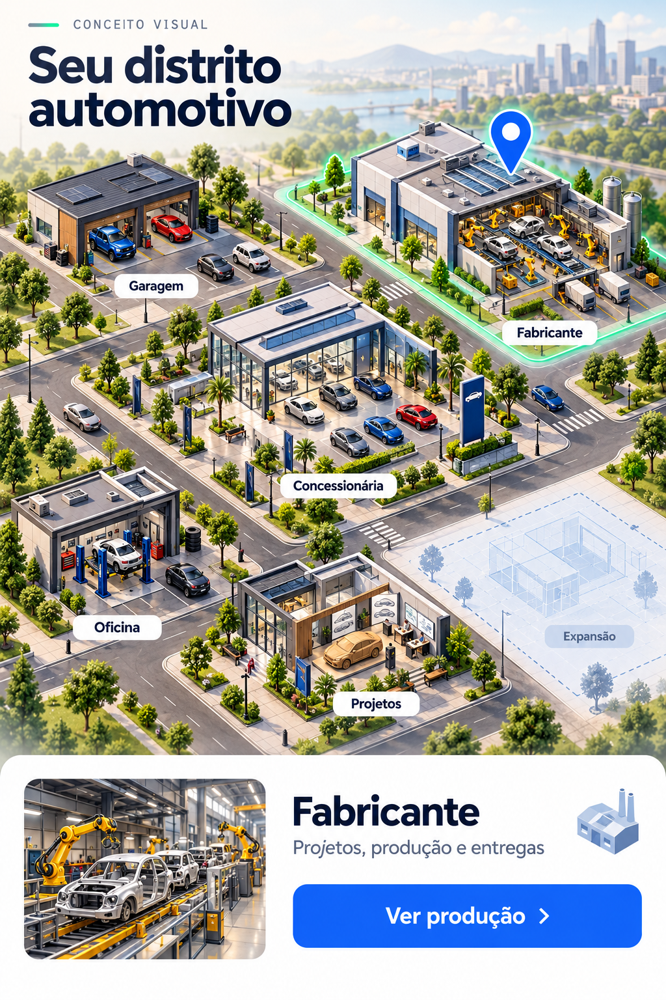

# Mapa da empresa e imagens que orientam o jogador

Atualizado em 23/10/2026. A primeira versão interativa está no jogo: garagem, fabricante e projetos abrem as telas reais e mostram o estado da campanha. A imagem abaixo continua sendo um conceito de expansão, não uma captura da interface atual.

## Primeira versão útil

O painel da garagem tem três construções tocáveis: **garagem, fabricante e centro de projetos**. Cada uma usa uma ilustração própria no atlas transparente `district-buildings.webp`, de aproximadamente 815 KiB, compartilhado e armazenado no cache offline. Tocar abre e focaliza a seção correspondente. Escritório e rede industrial continuam como propostas para próximas versões. O mapa complementa os menus atuais, sem custo novo nem alteração do formato da campanha.

| Ponto tocável | Informação útil | Ação |
| --- | --- | --- |
| Garagem / showroom | Estoque, vagas e propostas pendentes | Abrir estoque ou analisar propostas |
| Fabricante | Aberta ou não, linhas ocupadas e próxima entrega | Abrir fundação ou ordens de produção |
| Projetos | Pontos P&D e modelos homologados | Abrir desenvolvimento e escolher projeto |
| Escritório (futuro) | Caixa, reputação e alertas financeiros | Abrir Gestão / Finanças |
| Rede industrial (futuro) | Plantas e ordens por unidade | Selecionar unidade e administrar produção |

Cada prédio mostra um estado legível, acompanhado de texto. A garagem informa estoque, propostas, vagas livres e reservas da produção. A fabricante informa fundação e capital faltante, linhas principais ocupadas e próxima entrega, além de alertas de crise, estoque cheio ou falência. Projetos mostra pontos P&D e modelos homologados. Uma fábrica ainda fechada exibe o custo e leva diretamente à fundação. Ordens de outras unidades aparecem em um aviso separado; a previsão da construção principal usa apenas a fila dessa unidade.

Os controles têm pelo menos 44 × 44 pixels CSS. O toque abre a seção existente e move o foco até ela; nomes e números são texto da interface, separados das imagens. O mapa informa se a simulação está pausada e que os prazos usam dias do jogo. Não há transporte ou produção em segundo plano novos. O relógio sozinho não reconstrói o mapa, e a redução de movimento é respeitada. A validação física no iPhone continua pendente.

## Outras imagens que ajudam a jogar

- **Fábrica por dentro:** visão em corte com os veículos do lote e uma barra do prazo total. A cena trabalha apenas quando há ordens; informa quando falta vaga ou a produção está suspensa. Etapas detalhadas de montagem exigem uma mecânica própria antes de serem apresentadas como reais.
- **Fluxo visual do veículo:** cartões e setas ligando projeto homologado, ordem, produção e estoque. Cada etapa leva ao próximo comando e explica o requisito que falta.
- **Álbum de modelos e pinturas:** aproveitar as 160 imagens para registrar conquistas e histórico de posse. Completar famílias rende exposição, placas e decoração. O catálogo atual continua acessível.
- **Clientes reconhecíveis:** retratos, preferências e pequenos objetivos para os compradores existentes. O retorno de um cliente conecta uma história a uma nova decisão comercial.
- **Garagem que cresce:** fachada, piso, iluminação, escritório, equipe e troféus mudam com os marcos. O jogador reconhece o que conquistou ao voltar.

O conceito inclui uma oficina e um terreno de expansão como possibilidades visuais futuras. Isso não significa que já existam prédios independentes ou novas capacidades no jogo.

## Separar operação e geografia

O primeiro mapa é esquemático: mostra a organização da empresa. A rede geográfica pode ser uma segunda visão, apoiada nas 16 cidades e nas filiais existentes.

Hoje a fabricante principal e até cinco plantas adicionais compartilham fila e estoque. `plantId` identifica a unidade, mas as plantas não têm cidade ou coordenadas persistidas. A entrega ocorre no avanço dos dias; não existe percurso de caminhão com prazo próprio. Antes de posicionar fábricas num mapa mundial, precisamos definir localização da fábrica, destino da ordem e regras de transporte. Os saves antigos precisam de uma migração explícita.

## Evolução junto da campanha

Começo: garagem pequena e silhueta da futura fabricante. Primeiras conquistas: letreiro, exposição e decoração. Meio de jogo: showroom, escritório e primeiras unidades. Late game: campus industrial, visão da rede e controles avançados dos gerentes conquistados.

Prioridade: **usar a imagem para encontrar e executar uma ação**. A primeira entrega deve provar que as pessoas conseguem abrir a fabricante e acompanhar uma ordem pelo mapa; depois ampliamos o cenário.
